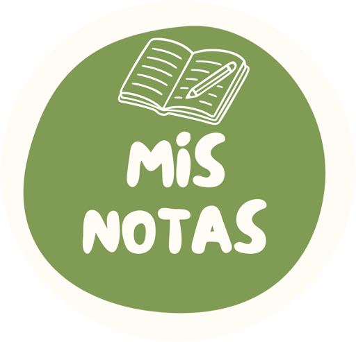

<p align="center">
  
</p>

<h1 align="center">Mis Notas para escritorio</h1>

<p align="center">
  Notas en Markdown para Windows, macOS y Linux, con carpetas, cifrado de extremo a extremo y sincronización con tu propio Nextcloud.
</p>

<p align="center">
  <a href="LICENSE"></a>
  <a href="https://github.com/ferlagod/mis_notas_desktop/actions/workflows/desktop.yml"></a>
  
</p>

---

Es la versión de escritorio de [Mis Notas para Android](https://github.com/ferlagod/mis_notas). Comparten el formato de sincronización, así que puedes usar el mismo Nextcloud y la misma contraseña maestra en el móvil y en el ordenador: las notas, carpetas e imágenes se sincronizan entre todos tus dispositivos.

## Características

- **Local primero**: funciona sin conexión y sin cuenta. La sincronización es opcional.
- **Carpetas anidadas** con colores, notas fijadas y papelera con restauración (y vaciado automático a los 30 días, desactivable).
- **Markdown**: títulos, negrita, cursiva, tachado, código, citas, listas, listas numeradas, tablas, enlaces, separadores y **listas de tareas** que se marcan con un clic.
- **Editor cómodo**: deshacer y rehacer, las listas continúan solas al pulsar Intro, barra de formato, contador de palabras y tiempo de lectura.
- **Atajos de teclado** (Ctrl en Windows y Linux, Cmd en macOS):

  | Atajo | Acción |
  |-------|--------|
  | Ctrl/Cmd + N | Nueva nota |
  | Ctrl/Cmd + R | Sincronizar ahora |
  | Ctrl/Cmd + , | Ajustes |
  | Ctrl/Cmd + L | Bloquear la app (si el bloqueo está activado) |
  | Ctrl/Cmd + B / I / K | Negrita / cursiva / enlace en el editor |
  | Ctrl/Cmd + Z, Ctrl/Cmd + Mayús + Z (o Ctrl + Y) | Deshacer / rehacer |
  | Esc | Volver (cerrar la nota, salir de la selección…) |

- **Lista y nota lado a lado** en ventanas anchas. La app recuerda el tamaño y la posición de la ventana.
- **Imágenes** adjuntas (varias a la vez; se comprimen a WebP y se sincronizan como ficheros cifrados aparte) con visor y zoom.
- **Selección múltiple** con clic derecho: fijar, cambiar color, mover de carpeta o borrar varias notas, con **"Deshacer"** al mandar algo a la papelera.
- **Vista de cuadrícula o lista**, orden por fecha o título, búsqueda instantánea que ignora acentos y resalta los resultados.
- **Exportar una nota** como fichero `.md` o copiarla al portapapeles.
- **Copia de seguridad en Markdown**: exporta todo a un ZIP (carpetas, imágenes y metadatos) e importa `.zip`, `.md` y `.txt`. Es compatible con Obsidian, Joplin, etc., y con la copia de la app de Android.
- **Bloqueo de la app** con una contraseña propia, que se pide al abrirla y tras un minuto fuera de ella.
- **Sincronización con Nextcloud** (WebDAV) automática: al abrir la app, al editar, al volver a la ventana y cada 30 minutos mientras está abierta.
- **Cifrado de extremo a extremo** AES-256-GCM con una contraseña maestra que nunca sale del ordenador.
- **Sin conflictos silenciosos**: si una nota se edita a la vez en dos dispositivos, se conservan ambas versiones.
- Diseño de la familia **Mis Apps**: tipografías Outfit e Inter, verde del logo como color principal y tema claro, oscuro o del sistema, con opción de negro puro.
- **En español, inglés, francés, alemán e italiano**: se elige en Ajustes (o "Idioma del sistema").
- Sin anuncios ni rastreadores.

## Instalación

Descarga el instalador de tu sistema desde la página de [Releases](https://github.com/ferlagod/mis_notas_desktop/releases):

| Sistema | Fichero | Notas |
|---------|---------|-------|
| **Windows 10/11** | `.msi` o `.exe` | Se instala para tu usuario, sin permisos de administrador. |
| **macOS** | `.dmg` (`-arm64` para Apple Silicon, `-x64` para Intel) | Arrastra *Mis Notas* a Aplicaciones. Mientras la app no esté firmada por Apple, la primera vez ábrela con **clic derecho → Abrir**. |
| **Linux** (Debian, Ubuntu…) | `.deb` | `sudo apt install ./mis-notas_*.deb` |
| **Linux** (Fedora, openSUSE…) | `.rpm` | `sudo dnf install ./mis-notas-*.rpm` |

Los instaladores incluyen su propio Java: no hace falta instalar nada más.

### Dónde se guardan los datos

| Sistema | Carpeta |
|---------|---------|
| Windows | `%APPDATA%\Mis Notas` |
| macOS | `~/Library/Application Support/Mis Notas` |
| Linux | `~/.local/share/mis-notas` (o `$XDG_DATA_HOME/mis-notas`) |

Para una instalación portátil o para hacer pruebas, se puede usar otra carpeta con la variable de entorno `MISNOTAS_DATA_DIR`.

## Conectar con Nextcloud

1. En la web de tu Nextcloud ve a **Ajustes personales → Seguridad → Dispositivos y sesiones** y crea una **contraseña de aplicación** (por ejemplo "Mis Notas escritorio"). No uses tu contraseña normal.
2. En la app abre **Ajustes** (icono de engranaje o Ctrl/Cmd + ,) → **Sincronización con Nextcloud** e introduce:
   - **Servidor**: la dirección de tu Nextcloud, p. ej. `https://nube.ejemplo.com`. También puedes pegar una URL WebDAV completa (`https://…/remote.php/dav/files/usuario/carpeta`).
   - **Usuario** y la **contraseña de aplicación** del paso 1.
   - **Contraseña maestra**: la que cifra tus notas. Si ya usas Mis Notas en el móvil, pon **la misma**.
3. Pulsa **Conectar y cifrar**. Si la carpeta `MisNotas` ya existe en tu Nextcloud (porque la creó otro dispositivo), la app la usa; si no, la crea y sube tus notas cifradas.

> [!WARNING]
> **Si olvidas la contraseña maestra, no hay forma de recuperar las notas guardadas en el servidor.** Ni el administrador de Nextcloud ni el autor de la app pueden descifrarlas. Guárdala en un gestor de contraseñas.

## Seguridad en breve

- La clave se deriva de tu contraseña maestra con PBKDF2-HMAC-SHA256 (600.000 iteraciones) y un *salt* aleatorio.
- Cada nota, carpeta e imagen se cifra con AES-256-GCM antes de salir del ordenador. El título, el contenido, la carpeta, el color y las fechas van dentro del bloque cifrado.
- Las credenciales y la clave se guardan cifradas; la clave de ese fichero está en el **llavero del sistema** (Llavero de macOS, Administrador de credenciales de Windows o Secret Service en Linux).

Lo que **no** protege: el servidor puede ver cuántas notas tienes, su tamaño aproximado y cuándo cambian. En el ordenador las notas se guardan sin cifrar en la carpeta de datos de la app; para protegerlas activa el cifrado de disco del sistema (FileVault, BitLocker o LUKS).

Detalles técnicos en [SECURITY.md](SECURITY.md) y en el [formato de sincronización](docs/SYNC_FORMAT.md).

## Cómo funciona la sincronización

- Cada nota y carpeta es un fichero JSON cifrado en `MisNotas/` de tu Nextcloud (`note_<id>.json`, `folder_<id>.json`); las imágenes son `att_<id>.bin`.
- La app usa los ETag de WebDAV para descargar solo lo que ha cambiado y `If-Match` al subir, para no sobrescribir nunca un cambio que no ha visto.
- **Conflictos**: si la misma nota cambió en dos sitios, se queda la versión más reciente y la otra se guarda como una nota nueva con el título "… (conflicto)".
- **Borrados**: la papelera se sincroniza entre dispositivos. Al vaciarla, la app deja en el servidor una "lápida" para que el resto de dispositivos también la borren.
- **Freno ante borrados masivos**: si en una sincronización el servidor quiere borrar o mandar a la papelera de golpe muchas notas (5 o más y al menos una cuarta parte de las que tienes, o 50 o más), la app no lo aplica: conserva las notas, las vuelve a subir y lo indica en Ajustes.
- **Copia antes de conectar**: al conectar una cuenta, la app guarda primero un ZIP con todas tus notas en `Descargas/MisNotas`. Se puede importar desde Ajustes.

## Compilar desde el código

Necesitas JDK 21 (Gradle lo descarga solo si no lo tienes).

```bash
git clone https://github.com/ferlagod/mis_notas_desktop.git
cd mis_notas_desktop
./gradlew run                                # abre la app
./gradlew :app:test                          # tests unitarios
./gradlew packageDistributionForCurrentOS    # instalador de tu sistema
```

Los instaladores se generan en `app/build/compose/binaries/main/`. Cada sistema solo puede generar los suyos (`.dmg` en macOS, `.msi`/`.exe` en Windows, `.deb`/`.rpm` en Linux); el flujo de GitHub Actions [`desktop.yml`](.github/workflows/desktop.yml) los genera todos y, al subir una etiqueta `v*`, los adjunta a un borrador de *release*.

## Estructura del proyecto

```
app/src/main/kotlin/com/ferlagod/misnotas/
├── Main.kt            Ventana, menú, atajos, bloqueo y cierre ordenado
├── AppNavigation.kt   Navegación entre pantallas
├── data/
│   ├── attachment/    Almacén local de imágenes adjuntas
│   ├── backup/        Exportar/importar notas en Markdown (ZIP)
│   ├── local/         Room (SQLite incluido): entidades, DAOs, árbol de carpetas, preferencias
│   ├── remote/        Cliente WebDAV (OkHttp)
│   └── sync/          Bóveda, formato remoto, reglas de fusión y sincronización periódica
├── i18n/              Textos traducidos (lee los strings.xml)
├── platform/          Carpetas por sistema, llavero, diálogos de ficheros, Esc = "atrás"…
├── security/          Cifrado (PBKDF2 + AES-GCM)
├── ui/                Pantallas Compose, componentes, tema, lector y editor Markdown
└── util/              Imágenes, idioma, fechas, búsqueda y bloqueo de la app

app/src/main/resources/i18n/values*/strings.xml   Textos (inglés por defecto; es, fr, de, it)
```

La interfaz usa [Compose Multiplatform](https://www.jetbrains.com/compose-multiplatform/), así que gran parte del código es el mismo que el de la app de Android.

## Limitaciones conocidas

- Todavía no se puede **cambiar la contraseña maestra** de una cuenta existente.
- Las imágenes que ya no usa ninguna nota se borran del ordenador, pero **no del servidor**.
- Solo admite imágenes como adjuntos.
- Los instaladores todavía no están firmados (macOS y Windows avisarán la primera vez).

¿Ideas o fallos? Abre una [incidencia](https://github.com/ferlagod/mis_notas_desktop/issues).

## Contribuir

Las contribuciones son bienvenidas. Lee [CONTRIBUTING.md](CONTRIBUTING.md) antes de abrir un *pull request*. Para vulnerabilidades, sigue [SECURITY.md](SECURITY.md).

## Créditos

- Tipografías [Outfit](https://github.com/Outfitio/Outfit-Fonts) (© 2021 The Outfit Project Authors) e [Inter](https://github.com/rsms/inter) (© 2016 The Inter Project Authors), bajo la [SIL Open Font License 1.1](https://openfontlicense.org). La licencia va incluida en los propios ficheros de fuente.

## Licencia

Copyright © 2026 ferlagod

Este programa es software libre: puedes redistribuirlo y/o modificarlo bajo los términos de la **Licencia Pública General de GNU** publicada por la Free Software Foundation, ya sea la versión 3 de la Licencia o (a tu elección) cualquier versión posterior.

Se distribuye con la esperanza de que sea útil, pero **SIN NINGUNA GARANTÍA**; ni siquiera la garantía implícita de COMERCIABILIDAD o IDONEIDAD PARA UN PROPÓSITO PARTICULAR. Consulta el fichero [LICENSE](LICENSE) para más detalles.

*Nextcloud es una marca registrada de Nextcloud GmbH. Este proyecto no está afiliado a Nextcloud GmbH, Apple, Google, Microsoft, Joplin ni Notesnook.*
